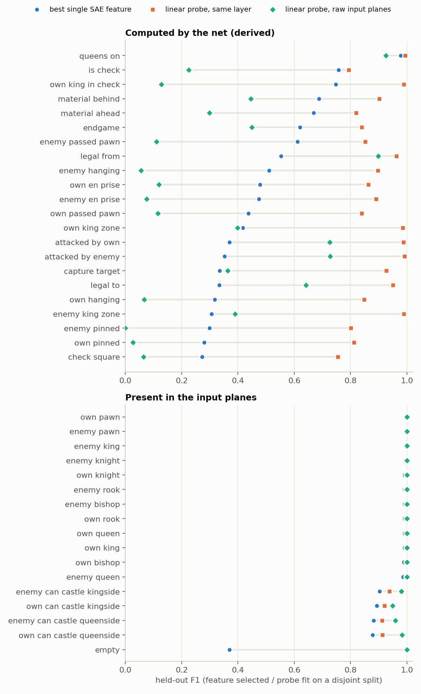
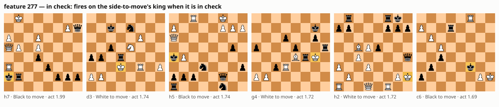
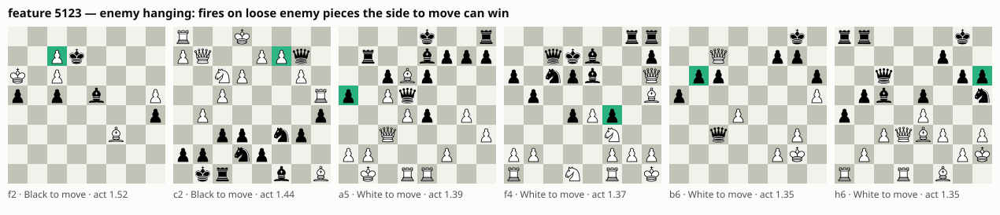
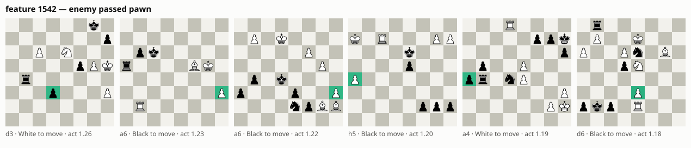
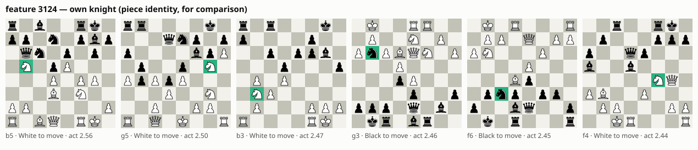
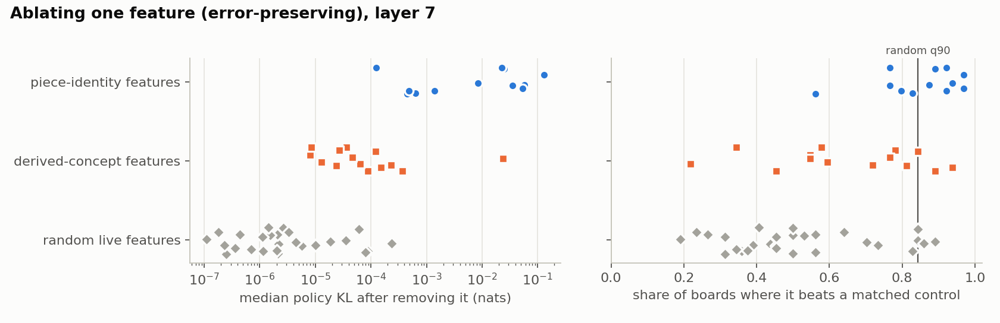
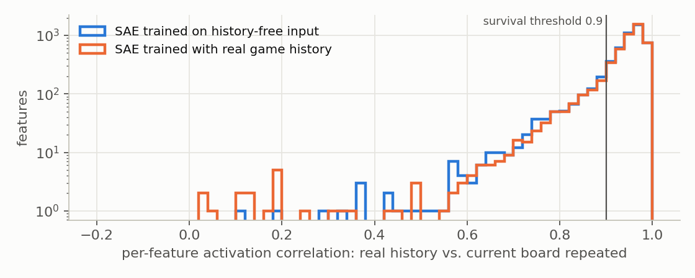
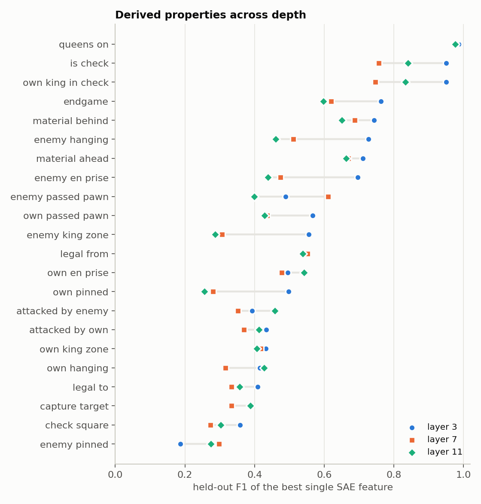

# Results: sparse autoencoders on Leela Chess Zero

What we trained, what we found, and — because a large part of this project turned out to be
finding our own mistakes — what the first version got wrong. Every number below is on held-out
Lichess games (never seen in SAE training or feature selection) unless stated otherwise.

## TL;DR

- **The pipeline was mostly right where it mattered least and wrong where it mattered most.** The
  activation site, token ordering and SAE math checked out. But the policy head was read with ~94%
  of its probability mass on untrained illegal-move slots, castling and promotions were mis-decoded,
  and the headline correlational and causal results from the first pass were artifacts (a "perfect"
  en passant feature for a property the net literally cannot see; a causal control that never
  fired). All fixed; details in [§1](#1-audit-what-the-first-version-got-wrong).
- **The SAEs are decent reconstructions.** At layer 7 (of 15) a Top-K SAE (k=32, 6144 features)
  explains 85% of the residual variance; spliced into the net, Leela still picks the same move in
  90% of positions (vs 7% if the layer is replaced by its mean). Its errors are ~2.5× more harmful
  than random noise of the same size — they fall in directions the net uses.
- **Piece identity is everywhere and causally used.** Every layer has "own knight here" / "enemy
  pawn here"-style features (held-out F1 ≈ 0.99 at layers 3 and 7, ≥ 0.88 at layer 11). Expected —
  it is the input, carried forward — but removing one does change play: ablating the own-knight
  feature cuts the probability of knight moves by ~20% and changes the top move in 28% of positions.
- **Computed concepts are in the dictionary, but spread out.** Check, hanging pieces, pins and passed
  pawns cannot be read off a square's own input planes (probe F1 ≤ 0.13) but are linearly decodable
  from the residual stream (0.80–0.99) — and from the SAE's *reconstruction* almost as well (e.g. pins
  0.81 vs 0.81, hanging 0.85 vs 0.90), while the SAE's error carries almost none of it (≤ 0.09). Some
  have a clean single feature ("my king is in check": F1 0.95 at layer 3); most are split over many:
  for hanging pieces, pins and passed pawns even the best 30 features fed to a probe reach only
  0.55–0.72.
- **Removing one such feature barely matters; removing the group does.** A single derived-concept
  feature changes the policy by ~10⁻⁴ nats. But removing the 30 non-piece features most associated
  with "enemy piece hanging" makes Leela ~20% less likely to capture the hanging piece (activation-
  matched control: no change). Writing features in works too, at 3× their typical activation:
  "in check" on a king that isn't in check → +47% king moves; "hanging" on a defended enemy piece →
  +6% captures (+3.8% / +1.4% at 1×). Two of four steering hypotheses held.
- **History is not a big confound here.** Feeding real game history instead of the repeated current
  board barely changes the policy for most positions (median KL 0.005 nats; mean 0.019), and 78–87%
  of measurable features stay put, including every concept feature above. The filter has teeth: an SAE
  trained *with* real history learns a "the last move landed here" feature (F1 0.78), which the
  filter rejects (correlation 0.13).
- **The board can be fully reconstructed from SAE features — but in Leela that proves little.**
  With the board-reconstruction metric of [Karvonen et al. 2024](https://arxiv.org/abs/2408.00113),
  the paper this project's eval was modelled on, layer-7 features rebuild the board with F1 0.98 and
  get every square right in 61% of positions (linear probe: 0.99 / 89%). That paper's
  chess-language-model SAEs reach 0.85, but the numbers aren't comparable: Leela is *given* the
  board, and an SAE on a freshly initialized, untrained copy of the net does as well (F1 0.98).
  Training shows instead in the form of the features — in the trained net 79 square-agnostic
  features are the best match for all 668 piece-on-square properties; the untrained net's SAE needs
  608 — and in computed properties: the trained net's SAE has a check detector (coverage 0.94), the
  untrained one does not (0.19; a classifier that always says "check" scores 0.11).
- **The original training data was the wrong data.** The 30k-FEN Hugging Face corpus looks like
  random play (no endgames; 41% of positions have a ≥ 3-pawn material imbalance). At equal budget,
  an SAE trained on it reconstructs real games far worse (FVU 0.29 vs 0.20) than one trained on
  Lichess positions.

## Setup

| | |
|---|---|
| Net | `lczerolens/BT3-768x15x24h-swa-2790000`: 15 transformer blocks, d_model 768, 64 square-tokens |
| Site | `encoderN/ln2`, the residual stream after block N (post-LayerNorm architecture, so this is exactly block N+1's input). Layers 3, 7, 11 |
| Input | history-free: a bare FEN with the current board copied into all 8 history slots (lc0's own FEN convention). Real history only in §6 |
| Data | 316k positions from June 2024 Lichess games, both players ≥ 2000, ≥ 3+0, no bots; 2 random plies per game; split by game (90/5/5); de-duplicated by position, no held-out position also in train |
| SAE | Top-K, k = 32, 6144 features (8×), tied init, unit-norm decoder, AuxK dead-latent revival (Gao et al. 2024) |
| Training | 200k boards × 64 tokens = 12.8M tokens, 2 epochs, Adam (lr 3.3e-4, warmup, linear decay), ~6 min on a laptop RTX 5050 |
| Eval samples | validation split (V) for selection/fitting, test split (T) for every reported number. SAE feature selection: 4000 V / 4000 T boards; linear probes and the feature-splitting table: 1500 V / 1500 T; fidelity: 1000 T; ablations: 64 boards per feature; joint ablation: 128 per property; steering: 300 trials per hypothesis; history: 1500 T (3000 for the positive control); data comparison: 500 per source |

## 1. Audit: what the first version got wrong

Three independent agent auditors (hook/data, SAE/training, evaluation) reviewed the code and
re-ran its claims on the GPU; the fixed version and this write-up were then audited twice more. In rough
order of how much they mattered:

| Problem | Effect on the original results | Fix |
|---|---|---|
| Policy logits include 1858 move slots, most illegal; lc0 never trains illegal logits | 94% of a full softmax's mass sat on illegal moves, so the `loss_recovered` and causal KLs mostly measured junk (rank correlation with the legal-only KL: 0.63–0.87) | Softmax over legal moves only, everywhere |
| Castling scored at the wrong slot (lczerolens uses e1g1; lc0 encodes king-takes-rook, e1h1) | `predict_move` effectively never castled; castling mass missing from every KL | Remap castling in `hook.policy_index` |
| `decode_move` drops the promotion piece | Promotions returned as illegal moves; 2 of 9 "missed" mate-in-ones were correct | Score legal moves, return the move itself |
| En passant is invisible under the history-free encoding (no ep input plane; lc0 infers ep from history) | Reported en passant feature with F1 = **1.000** was impossible — 1 positive in 300 boards | Property marked hidden; only meaningful with real history |
| Board-level F1 = argmax over 6144 features, scored on the same 300 boards | Selection artifacts: shuffled labels reach the reported values; re-scored on disjoint boards (first audit, original SAE and eval set) en passant 1.00 → 0.00, "castled" 0.40 → 0.00, check 0.36 → 0.06 | Select on one split, report on another, with permutation null and always-true baseline |
| Causal "random control" was not active on the board (87.6% of the time), and each test used one board | The "control KL = 0" was true by construction | Error-preserving ablation, 64 boards where the feature is active, activation-matched control features on the same board, calibrated against random features |
| `loss_recovered` vs zero-ablation | Zeroing (or mean-ablating) this layer destroys ~2 nats of policy, so nearly any SAE scores ≈ 0.99 | Headline raw legal KL, top-1 agreement, ΔQ, and an equal-norm noise reference |
| Training data (30k HF FENs) | Off-distribution, small (1.15M tokens), no move history — see §8 | Lichess corpus, 11× more tokens |
| Random encoder init; dead-latent window of 100k tokens; AuxK picked negative pre-activations | 2.6–5% dead latents, 20% nearly dead; the window flagged 18.5% of latents as dead, 86% of which were alive | Tied init, 2M-token window, ReLU'd AuxK |
| Tests that could not fail | e.g. the causal test passed for 4 of 4 deliberately broken harnesses; the F1 test could not tell F1 from precision | Tests with hand-computed asymmetric cases and "power" checks that must fail when nothing is patched |
| Found while redoing the eval: the linear-probe threshold was searched on a coarse quantile grid | Probes looked bad on rare properties (in-check: AUROC 1.0 but F1 0.30), which would have made one SAE feature look better than a probe | Exact threshold search |
| Found by the second audit, in the first draft of this write-up | Claimed the part of each concept missing from single features "lives in the SAE's reconstruction error" — the opposite is true (§4); a pawn-identity feature was listed as a derived concept; several overstatements | Corrected below |
| Found by a third audit, of the board-reconstruction section (§10) | Credited training with "cleaner" features on a threshold-dependent gap that the paper's own protocol reverses; compared with the paper as if like for like; reported strategy coverage without the always-fires baseline; said the permuted net lost the board entirely | Corrected in §10, with the checks in `scripts/14` |

What was right from the start: the activation site, the token ↔ square mapping (including the
vertical flip for Black to move), batched capture, the WDL head (probabilities, side-to-move view),
the SAE's encode/decode math, and the per-square piece-identity results.

## 2. Does the hook read the net correctly?

There is no lc0 binary here to give a reference move, so the gate uses positions with known
answers. The policy head alone (no search) on 1000 random Lichess puzzles:

| puzzle rating | ≤ 1000 | 1000–1500 | 1500–2000 | 2000–2500 | > 2500 | all |
|---|---|---|---|---|---|---|
| top-1 = solution | 99.1% | 99.1% | 90.3% | 85.9% | 75.6% | **93.8%** |

It finds mate in all 134 mate-in-one puzzles, castles and promotes correctly. With the history
planes zeroed instead (off-distribution), the top move changes in 94 of 100 positions.

## 3. Reconstruction fidelity

All on the same 1000 test boards. KL is KL(clean ‖ SAE-spliced) over legal moves; "noise" splices
in isotropic Gaussian noise with the same per-token norm as the SAE's error.

| SAE | FVU | KL (nats) | top-1 move unchanged | mean \|ΔQ\| | KL with equal-norm noise | error vs noise |
|---|---|---|---|---|---|---|
| layer 3 | 0.112 | 0.0085 | 92.7% | 0.020 | 0.0036 | 2.4× |
| layer 7 | 0.151 | 0.020 | 89.6% | 0.032 | 0.0083 | 2.5× |
| layer 11 | 0.173 | 0.027 | 89.4% | 0.029 | 0.0108 | 2.5× |
| layer 7, original SAE (HF data, old code) | 0.309 | 0.065 | 83.7% | 0.056 | 0.0156 | 4.2× |

FVU is relative to the global mean activation; relative to each square's own mean, layer 7's is
0.176. Replacing layer 7 by its per-square mean gives KL 2.2 nats and 7% top-1 agreement, so
"loss recovered" is 0.99 for every row — not a useful number at this site. Deeper layers are harder
to reconstruct. A higher learning rate (1e-3) is marginally better at layer 7 (FVU 0.147).
Latents dead at the end of training (no activation in 2M tokens): 0.6% / 0.05% / 0.02% at layers
3 / 7 / 11.

## 4. Do features match chess properties?

For each property we take the single feature with the best F1 on validation boards and report its
F1 on test boards, next to two linear probes fit on validation boards: one on the layer's full
residual stream (is the information linearly there?) and one on the square's own 112 input planes
(is it readable from that square's input alone?). Caveats: a feature "fires" when its activation is
above zero, while probes get a tuned threshold (the AUROC columns in the generated tables are
threshold-free); SAE scores use 4000 test boards, probes 1500.

- **Input properties** (piece identity, castling rights) have near-perfect single features.
  Expected, and a good sanity check — but not a discovery.
- **Derived properties** are computed: square-local input probes fail (hanging 0.06, pinned 0.03,
  in-check 0.13; a square's own planes can't show its attackers) while residual probes succeed
  (0.75–0.99). Single SAE features recover a fraction of that. At layer 7: in-check 0.75, enemy
  passed pawn 0.61, enemy hanging 0.51, pins ≤ 0.30.
- **Dense relational maps** (squares attacked, legal destinations, king zones) are almost perfectly
  decodable (0.95–0.99) but no single feature tracks them (≤ 0.42, below the trivial "always fires"
  score for the densest ones).

**Split, or missing?** Layer 7, test F1 of probes fit on: the n best features' activations; the
SAE's reconstruction x̂; the SAE's error x − x̂; the full residual x.

| property | always fires | 1 feature | 3 | 10 | 30 | x̂ (reconstruction) | x − x̂ (error) | x |
|---|---|---|---|---|---|---|---|---|
| own king in check | 0.00 | 0.74 | 0.95 | 0.96 | 0.96 | 0.96 | 0.03 | 0.99 |
| enemy hanging | 0.01 | 0.56 | 0.69 | 0.70 | 0.72 | 0.85 | 0.03 | 0.90 |
| own pinned | 0.00 | 0.23 | 0.44 | 0.54 | 0.63 | 0.81 | 0.09 | 0.81 |
| enemy passed pawn | 0.01 | 0.65 | 0.62 | 0.60 | 0.64 | 0.75 | 0.04 | 0.85 |
| squares attacked by enemy | 0.68 | 0.68 | 0.68 | 0.75 | 0.82 | 0.98 | 0.69 | 0.99 |

The concepts are in the dictionary — a linear readout of the reconstruction recovers most of what
the full residual stream has, and the error alone recovers nothing beyond the trivial baseline —
but spread across many features. "In check" needs ~3 at layer 7 (at layers 3 and 11 a single
feature does it); hanging pieces, pins and passed pawns need more than 30. For "squares attacked",
1–3 features score exactly the always-fires baseline: the probe gave up.

**What the matched features look like** (top activations on test boards, from the side to move's
view; highlighted square = where the feature fires):

## 5. Do they matter to the policy?

**Single-feature ablation.** Remove one feature's contribution from the true activation (keeping the
SAE's error and every other feature), on 64 test boards where it is active, and compare with a
control feature active on the same board with matched activation mass.

- Piece-identity features matter: median KL 10⁻⁴–10⁻¹ nats (pawns and knights highest, kings and the
  enemy queen and rook lowest). Ablating the own-knight feature drops the probability of moves
  touching its squares by 20% (Δlog p = −0.22; control +0.003) and changes the top move on 28% of
  boards (control 3%).
- Features for check, hanging / en-prise pieces and passed pawns beat their matched controls on
  77–94% of boards — but random features beat theirs on 48% (median) and up to 84% (90th
  percentile), so only some clear that bar. Their absolute effect is ~10⁻⁵–10⁻⁴ nats: above a typical
  random feature (~2·10⁻⁶), well below most piece features. Removing "in check" from a king in check
  changes almost nothing.

**Joint ablation.** Two readings fit that: the concept is spread over redundant features (removing
one leaves the rest), or later blocks recompute it from the intact board. Removing the top-n
features for a property *together* separates them. Layer 7, 128 test boards where the property
holds; piece-identity-like features (F1 > 0.3 against any piece type or "empty") excluded; control
= one activation-matched feature per removed feature, on the same board. Change in log P(moves
touching the property's squares), median, candidate vs control:

| property (moves measured) | top 1 | top 3 | top 10 | top 30 | KL, top 30 (control) |
|---|---|---|---|---|---|
| enemy hanging (captures of the hanging piece) | 0.00 / 0.00 | −0.005 / 0.00 | −0.07 / 0.00 | **−0.22 / 0.00** | 0.012 (0.0001) |
| own king in check (king moves) | 0.00 / 0.00 | −0.04 / 0.00 | −0.05 / 0.00 | −0.03 / 0.00 | 0.0023 (0.0001) |
| own pinned (moves of the pinned piece) | 0.00 / 0.00 | 0.00 / 0.00 | +0.02 / 0.00 | +0.03 / 0.00 | 0.0018 (0.0006) |
| enemy passed pawn (moves touching the pawn) | 0.00 / 0.00 | 0.00 / 0.00 | 0.00 / 0.00 | −0.01 / 0.00 | 0.0007 (0.0002) |

Removing the 30 "hanging" features makes Leela about 20% less likely to capture a hanging piece,
with no effect from the matched control: the concept is used, and spread out. "In check" behaves
partly like that (a ~4% drop in king moves once three features are removed, KL 30–150× the
control's) —
in check the legal moves are mostly evasions anyway, so there is less policy to move. For pins and
passed pawns the effects stay small; whether later layers recompute them or the policy simply
doesn't lean on them at this layer, this experiment can't say.

**Steering (sufficiency).** Write a feature, at its typical (90th-percentile) activation or 3× that,
onto a square where its property is false, and test a specific prediction. 300 test boards each;
controls are a different feature of the same activation scale, and a random direction of the same
norm, written on the same square.

| feature (layer 7) | written on | prediction | Δ P(predicted moves), 1× / 3× | boards where it rose (3×) | beats feature control / random direction (3×) |
|---|---|---|---|---|---|
| in check (277) | own king, not in check | more king moves | **+3.8% / +47%** | 95% | 94% / 94% |
| enemy hanging (5123) | defended enemy piece we can capture | more captures there | **+1.4% / +6.3%** | 78% | 76% / 79% |
| own hanging (5424) | attacked-but-defended own piece | move it away | +0.1% / +0.5% | 55% | 61% / 57% |
| own passed pawn (1581) | own pawn that isn't passed | push it | −0.3% / −1.2% | 32% | 45% / 35% |

Two clear successes, one null and one failure. (The in-check feature activates more strongly than
almost any other, so its feature-control pool has only 2 candidates; the random-direction control
does not have that problem.) The failures line up with the correlational evidence: feature 5424
only matches "own hanging" with F1 0.32 (auto-interp calls it a *defended* pawn), and "passed pawn"
may encode "advanced pawn near promotion" — which a blocked pawn is not.

**Scorecard against DESIGN.md's three checks.** Correlational: held-out F1 ≥ 0.5 and ≥ 0.1 above
the permutation null (which, for rare properties, is ~0.01 and never binds). Causal: single-feature
ablation beats matched controls more often than the 90th percentile of random features, on either
the KL test or the targeted-move test — a lenient bar that 14–18% of random features also clear.
History: §6. Derived-concept features (excluding ones that are also a piece-identity feature) passing
all three:

| layer | features passing all three checks |
|---|---|
| 3 | in check (F1 0.95), enemy hanging / en prise (0.73), material ahead (0.71), own passed pawn (0.57) |
| 7 | enemy passed pawn (0.61), enemy hanging (0.51) — both marginal on the causal bar |
| 11 | in check (0.84), own en prise (0.54) |

11 of 12 piece-identity features pass at layer 7 (own pawn misses the causal bar despite an 8×
larger effect than its control: its matched controls are other strong features). Given how lenient
the causal bar is, the joint-ablation and steering results above are the stronger causal evidence.
Full per-property tables are generated by `scripts/10_figures.py`.

## 6. Does history change the picture?

The SAEs never see move history. To check that their features track the board rather than an
artifact of the repeated-board encoding, we re-encoded 1500 test positions with their real Lichess
move history and compared every feature's activation on every square.

| | layer 3 | layer 7 | layer 11 |
|---|---|---|---|
| policy KL, real vs repeated history (median / mean) | 0.005 / 0.019 | 0.005 / 0.019 | 0.005 / 0.019 |
| SAE FVU: repeated → real history | 0.112 → 0.131 | 0.152 → 0.160 | 0.175 → 0.182 |
| measurable features (≥ 20 activations) | 3690 | 4913 | 5295 |
| … with activation correlation ≥ 0.9 | 81% | 87% | 78% |

History matters little for most positions, but its mean effect on the policy is as large as
splicing in the layer-7 SAE, so a minority of positions shift substantially. Every feature
discussed in §4–5 survives (correlation ≥ 0.94). The original SAE was far less stable: only 33% of
its measurable features survive.

**Does the filter have power?** A history-free SAE cannot contain history features, so it can't
show that. Positive control, at layer 7 on 3000 test positions with ≥ 8 plies of history:

- The residual stream does carry move history when it gets it: a linear probe for "the square the
  last move landed on" reaches F1 0.94 with real history, 0.44 without (the board alone gives
  partial clues, e.g. a piece that has just captured).
- The history-free SAE has no feature for it (best F1 0.18, with or without history).
- An SAE trained the same way on real-history activations (val FVU 0.157) does: feature 3879 tracks
  the last move's destination with held-out F1 0.78. The filter rejects it — its activation
  correlation between real and repeated history is 0.13, and without history its F1 falls to 0.04.

Overall survival is about the same for the two SAEs (85% vs 86%): most features that fail the 0.9
bar are just sensitive to the small shift real history causes, not history detectors. The real
history detectors show up as the small cluster near zero (14 features below 0.3 in the
real-history SAE, 3 in the history-free one).

## 7. Across depth

Single-feature matches for derived concepts are best at layer 3 (mean F1 over derived properties
0.58; in-check 0.95, enemy hanging 0.73, own pinned 0.50, enemy king zone 0.56). Layers 7 and 11
are similar (0.49 and 0.50) — except "in check", which is split across several features at layer 7
(0.75) and whole again at layer 11 (0.84). Reconstruction gets harder with depth (FVU 0.11 → 0.15 →
0.17), and the layer-3 dictionary has more very rare features (16% never fire on 256k test tokens,
vs 3% at layer 7 and 1% at layer 11).

## 8. Did the original data help?

Same code, same config, same number of steps, 18k boards each, layer 7; FVU / top-1 move agreement
on 500 held-out boards from each source:

| trained on ↓ / evaluated on → | Lichess test games | HF hold-out FENs |
|---|---|---|
| HF FENs (original) | 0.294 / 84.0% | 0.167 / 93.8% |
| Lichess games | **0.199 / 87.8%** | 0.219 / 89.2% |

The HF-trained SAE barely transfers to real games; the Lichess-trained one transfers to the HF
positions reasonably. The main run (11× the data and 5.6× the optimizer steps) reaches FVU 0.151 on
1000 Lichess test boards. The HF corpus was dropped.

## 9. Auto-interp

Claude (Sonnet, through the CLI) labeled 61 layer-7 features from their top activations, then — in
a fresh call with only the label — predicted which of 10 held-out boards (half where the feature
fires) it fires on, and where.

| features | n | balanced accuracy | firing square guessed |
|---|---|---|---|
| piece-identity features | 12 | 0.84 | 78% |
| other property-matched features | 19 | 0.61 | 41% |
| random live features | 30 | 0.60 | 23% |

Labels are fluent and usually plausible ("own fianchettoed bishop on g7 shielding the castled
king", "empty squares an enemy knight attacks"), but outside piece identity they predict held-out
firing only modestly — no better for the property-matched features than for random ones. Where the
labels describe property features they mostly agree with the property and add detail (the own-rook
feature fires most on passive back-rank rooks; the "own hanging" match is called a *defended* pawn,
consistent with its low F1). With 10 boards per feature, individual scores are noisy, and the
square-guess rate has no simple chance baseline (features that fire on many squares are easier);
only the averages should be read.

## 10. Can the board be fully reconstructed? (Karvonen et al. 2024)

The correlational eval in DESIGN.md was modelled on [Karvonen et al. 2024, "Measuring Progress in
Dictionary Learning for Language Model Interpretability with Board Game Models"](https://arxiv.org/abs/2408.00113),
which scores SAEs on chess and Othello models against the known board with two metrics
(`src/eval/board_reconstruction.py`, `scripts/13_board_reconstruction.py`):

- **Coverage**: for each "piece p on square s" property (768 of them), the best F1 any single
  feature achieves when it counts as firing above t × its maximum activation, t ∈ {0, 0.1, …, 0.9};
  averaged over properties.
- **Board reconstruction**: assign each feature to every (square, piece) it predicts with ≥ 95%
  precision on training positions; on test positions, predict the board from whichever assigned
  features fire; score with F1 over pieces, averaged over positions. We add the **exact-board rate**:
  the fraction of positions where every square comes out right — the board *fully* reconstructed.

Adapted to Leela: one token per square, so (s, p) is read at token s; pieces in the net's own/enemy
frame (equivalent, given the side to move); assignment and t chosen on all 15.5k validation boards,
scored on 2000 test boards (the linear probe: fit on 1500 validation boards, scored on 1500 test
boards). Baselines as in the paper — a linear probe, and SAEs trained the same way on random-weights
copies of the net. Two copies, because here the choice matters: permuting the trained weights
(keeping their scale) collapses all 64 tokens into one vector by layer 7 (variation within a board
is 0.05% of the total; mean cosine between tokens 1.000), while a conventional small-weight init
passes the input board through nearly unchanged (mean cosine 0.005).

| | coverage | board F1 | boards fully reconstructed | best-match features | strategy coverage |
|---|---|---|---|---|---|
| SAE, layer 3 | 0.999 | 0.986 | 67% | 59 | 0.81 |
| SAE, layer 7 | 0.994 | 0.983 | 61% | 79 | 0.78 |
| SAE, layer 11 | 0.977 | 0.966 | 34% | 81 | 0.79 |
| original SAE (layer 7) | 0.984 | 0.953 | 32% | 75 | 0.75 |
| SAE on an untrained net, fresh init (layer 7) | 0.995 | 0.978 | 47% | 608 | 0.71 |
| SAE on an untrained net, permuted weights (layer 7) | 0.31 | 0.09 | 0% | 499 | 0.52 |
| linear probe, layer 7 (trained net / fresh init) | — | 0.993 / 0.979 | 89% / 71% | — | — |
| *Karvonen et al., chess LM: best SAE / linear probe / random-net SAE* | *0.48 / 0.98 / 0.11* | *0.85 / 0.98 / 0.01* | — | — | — |

"Best-match features": how many distinct features are the best single-feature match for the 668
piece-on-square properties that occur in the test boards.

- **The board can be reconstructed almost perfectly, though not comparably with the paper.** Errors
  are rare: at layer 7, 0.56 wrong squares per board on average and 88% of boards within one square;
  about three in four errors are a spurious or wrong-type piece, one in four a missed piece. Own
  pieces are almost never missed (≤ 0.75%), enemy knights and bishops ~2% of the time. The paper's
  chess-LM SAEs score 0.85, but that model has one residual vector per position and needs a separate
  feature for every square. Leela has a token per square, so a single "own knight here" feature can
  serve all 64: at layer 7, one feature is the best match for 59 of the 668 properties.
- **But here that is not evidence of learning.** The paper's models read move text, so the board is
  something they must infer. Leela is *given* the board, and an SAE on an untrained, freshly
  initialized copy of the net reconstructs it as well. At the threshold chosen on training boards
  the trained net gets more boards exactly right (61% vs 47%), but that gap depends on the
  threshold: at t = 0.5 the fresh-init SAE gets 71%, more than the trained one's best (61%). Under
  the paper's own protocol, which takes the best threshold for each test board (its Eq. 5) and does
  not score pieces on their starting squares, fresh init is level or ahead: F1 0.998 vs 0.992, and
  0.985 / 75% exact vs 0.979 / 65%. The permuted-weight net shows only that random weights at
  trained scale scramble the board. Its tokens collapse to one vector, so no feature can say where a
  piece is (board F1 0.09). A probe from that shared vector to every square still recovers a coarse
  summary (F1 0.56, against 0.33 for guessing each square's most common class; the trained net's
  token average gives 0.53).
- **What training changes is the form of the features.** The trained net's SAE has square-agnostic
  piece features: 79 features are the best match for all 668 piece-on-square properties, one of them
  for 59. The fresh-init SAE needs 608, none the best match for more than 4. Reconstruction scores
  cannot tell the two apart.
- **The meaningful version of the test is the paper's "strategy" set** — properties that must be
  computed. Scored against a classifier that always says yes (F1 = 2p / (1 + p) at base rate p, the
  baseline of §4):

  | strategy property | always fires | trained net (L7) | fresh init (L7) |
  |---|---|---|---|
  | in check | 0.11 | **0.94** | 0.19 |
  | own pieces under attack (per square) | 0.06 | **0.58** | 0.45 |
  | some piece pinned | 0.31 | 0.40 | 0.33 |
  | a checking move exists | 0.63 | 0.65 | 0.64 |
  | legal-move destination (per square) | 0.48 | 0.50 | 0.56 |
  | a queen on the board | 0.87 | 0.98 | 0.87 |
  | bishop pair | 0.60 | 0.80 | 0.72 |
  | castling rights (4 properties) | 0.31–0.36 | 0.92–0.97 | 1.00 |

  The trained net's SAE has a check detector the untrained one lacks, and is better on own pieces
  under attack. Pins are only weakly above trivial for either, and for "a checking move exists" and
  legal-move squares neither beats always-fires. The queen and castling rows are readable from the
  input planes. The queen gap probably reflects the square-agnostic features above: one "queen here"
  feature fires wherever the queen stands, while the fresh-init SAE has no single such feature.
  Base rates differ from the paper's dataset, so these coverages can't be compared with its numbers.
- **The assignment rule needs data.** The paper's rule takes any feature that was ≥ 95% precise on
  the training positions; with few positions per (square, piece), features that fired once or twice
  get assigned by luck. With 2000 training boards layer 7 drops to F1 0.95 and 21% exact boards;
  requiring ≥ 5 firings raises the exact-board rate to 81% / 71% / 48% at layers 3 / 7 / 11.

Coverage is in-sample and threshold-optimized, as in the paper, so it reads higher than the held-out
single-feature F1s of §4 (e.g. "in check" 0.94 here vs 0.75 for §4's best feature, which labels the
king's square rather than the whole board). Two small departures from the paper make our numbers a
little conservative: coverage uses one threshold for all properties (the paper takes the best per
property), and reconstruction uses one threshold chosen on training boards (the paper, the best per
test board). Our "strategy" set is an analogue of the paper's: fork, ambiguous-move,
can-capture-queen and en-passant properties are omitted (en passant is invisible without history);
"a queen on the board" counts either side's queen; castling rights are scored for each side
separately. The checks in this section beyond scripts/13 come from
`scripts/14_reconstruction_checks.py` (`outputs/results/board_reconstruction_checks.json`).

## 11. DESIGN.md checklist

- [x] Hook reproduces Leela's move — proxy: 93.8% of 1000 puzzles, all 134 mate-in-ones (no lc0
  reference binary was available)
- [x] Top-K SAE trains; L0 = k; dead latents at the end of training 0.6% / 0.05% / 0.02% (layers 3/7/11)
- [x] Loss recovered measured — and replaced as a headline by legal KL / top-1 / noise reference
- [x] ≥ 1 feature with high F1 against a board property and a causal head effect — piece identity
  (strongly); "in check" (layer 3 feature 1304: F1 0.95, passes all three checks; layer 7 feature
  277: F1 0.75, steering +47% king moves at 3×); "enemy hanging" as a group of features (removing
  30 cuts captures of hanging pieces by ~20%)
- [ ] Ray pipeline + Accelerate scaling — dropped: unnecessary on one GPU
- [x] Auto-interp labels for top features

## Limitations

- One net, three layers, one SAE size and sparsity (k = 32, 8× expansion); no sweep over either.
- The properties are hand-picked; features that track concepts we didn't think to label are
  invisible to the correlational eval (auto-interp suggests many fire on empty squares in
  structured ways — escape squares, knight destinations).
- Single-feature F1 uses a fixed "fires or not" threshold while probes use a tuned one, which
  slightly favours the probes (e.g. layer 11's in-check feature: F1 0.84 at > 0, 0.96 tuned).
- The single-feature causal bar is lenient (14–18% of random features clear it) and based on 64
  boards per feature; the joint-ablation and steering results rest on one layer and a handful of
  hypotheses.
- Effects on the value head and on search were not studied.
- Random-weights baselines depend on how the net is randomized (§10): permuted trained weights
  collapse the tokens into one vector, a small fresh init passes the input through. Neither is "the"
  untrained net, and both were tested at layer 7 only.
- Positions come from human games ≥ 2000 Lichess rating, not Leela's own self-play distribution.
- The move-reproduction gate is a proxy; a check against the lc0 engine itself is still missing.

## Reproduce

See [README.md](README.md) — `scripts/00` … `scripts/14` regenerate every number and figure here
(≈ 5 hours on an 8 GB laptop GPU, plus ~2 GB of downloads and ~120 GB of activation caches).
